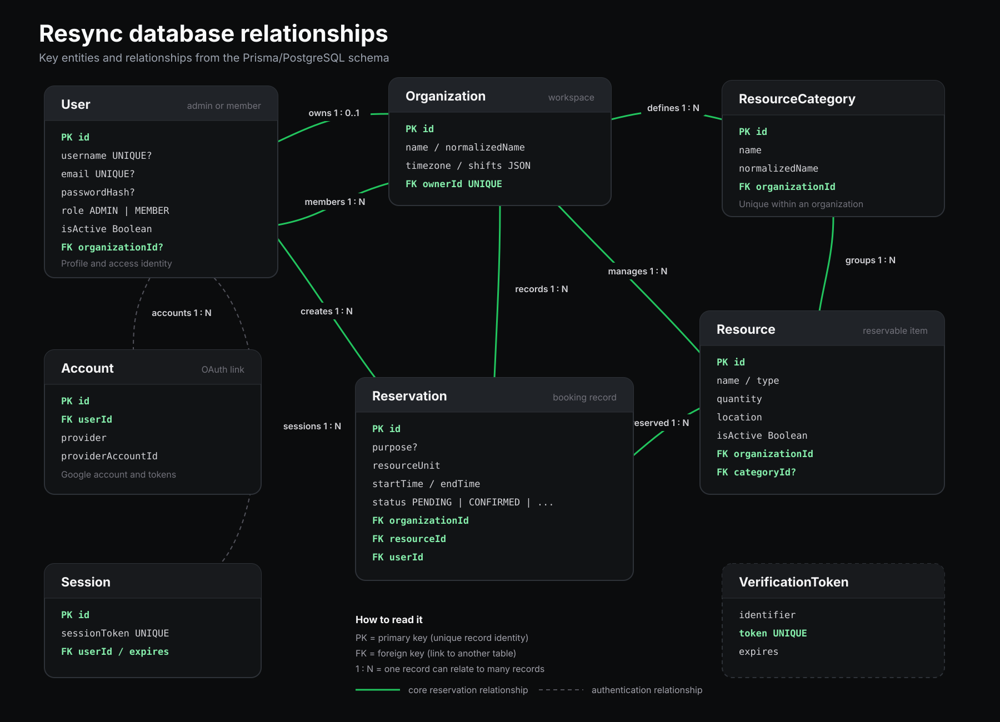

# Resync

Resync is a full-stack resource reservation management system for organizations that share rooms, equipment, workstations, vehicles, and other limited resources. It gives administrators one place to manage their workspace while helping members find available resources and reserve them without scheduling conflicts.

## Problem and solution

Shared resources are often coordinated through messages, spreadsheets, or other manual records. That approach makes availability unclear and allows overlapping reservations.

Resync centralizes resource information, employee access, availability, and reservations. It provides role-specific admin and member experiences, validates every mutation on the server, and prevents conflicting bookings for the same physical resource unit.

## Features

### Administrators

- Create an organization and configure its profile, timezone, shifts, and working hours.
- Add, edit, activate, deactivate, categorize, and delete resources.
- Track multiple physical units of the same resource independently.
- Add, update, activate, deactivate, delete, and reset passwords for employees.
- View organization activity and live resource availability from the overview dashboard.
- Create, edit, filter, and cancel reservations for organization members.
- Review reservations through daily, weekly, and monthly calendar views.
- Update organization and administrator account settings.

### Members

- Sign in with credentials created by an administrator.
- View the shared reservation timeline and bookings made by other members.
- Browse and filter active resources by category, location, and availability.
- Create, edit, and cancel personal reservations.
- Review personal reservations and organization availability in calendar views.
- Update profile details and change the account password.

### Reservation workflow

- Switch between configured Morning, Evening, and Night timelines.
- Navigate reservation dates and individual units of multi-quantity resources.
- Select available time directly from the timeline or enter precise start and end times.
- Prevent overlaps through server-side validation and serializable database transactions.
- Display current time, elapsed time, reservation ownership, and live availability.
- Refresh reservation views across connected clients through organization-scoped Socket.IO events.

## Technology stack

- Next.js 16 with the App Router
- React 19 and TypeScript
- Tailwind CSS
- PostgreSQL hosted on Neon
- Prisma ORM with the Neon serverless adapter
- Auth.js with JWT sessions, Google OAuth, and credentials authentication
- Zod validation
- Socket.IO for real-time reservation invalidation
- Git and GitHub for version control

## Engineering decisions

- **Server-enforced authorization:** API routes resolve the authenticated user, organization, and role before reading or changing protected data.
- **Conflict-safe reservations:** reservation writes run in serializable transactions and check the selected resource unit for overlapping active bookings.
- **Organization isolation:** resources, employees, and reservations are scoped to an organization in both database queries and real-time rooms.
- **Persistent storage:** application data is stored in PostgreSQL; Prisma migrations provide a reproducible schema history.
- **Timezone-aware scheduling:** date boundaries and displayed times use the organization timezone rather than the server timezone.
- **Minimal real-time payloads:** Socket.IO broadcasts only an invalidation event. Each client then reloads authorized data from the Next.js server.
- **Layered validation:** browser constraints improve usability, Zod validates request data, and database constraints protect uniqueness and relationships.

## Project structure

```text
prisma/
  migrations/                 Database migration history
  schema.prisma               Application data model
src/
  app/
    api/                      Authenticated API route handlers
    dashboard/                Administrator pages
    member/                   Member pages
    onboarding/               Organization setup flow
  components/                 Feature and shared UI components
  generated/prisma/           Generated Prisma client (ignored by Git)
  lib/
    auth/                     Authentication and authorization helpers
    dashboard/                Administrator data queries
    datetime/                 Timezone and calendar utilities
    realtime/                 Socket.IO client integration
    reservations/             Reservation validation
server.mjs                    Next.js and Socket.IO custom server
```

## Data model



The main entities are:

- `User`: administrator or member credentials, profile, role, and active state.
- `Organization`: company profile, owner, timezone, and shift configuration.
- `ResourceCategory`: organization-specific resource classification.
- `Resource`: reservable item, location, quantity, category, and active state.
- `Reservation`: resource unit, owner, time range, purpose, and status.
- `Account`, `Session`, and `VerificationToken`: Auth.js persistence models.

## Local setup

### Prerequisites

- Node.js 20.9 or newer
- npm
- A Neon PostgreSQL project
- A Google Cloud OAuth 2.0 web application for Google administrator sign-in

### 1. Clone and install

```bash
git clone https://github.com/catbot33/Resync.git
cd Resync
npm install
```

### 2. Configure environment variables

Copy `.env.example` to `.env` and replace every placeholder.

```bash
cp .env.example .env
```

On Windows PowerShell, use:

```powershell
Copy-Item .env.example .env
```

Required variables:

- `DATABASE_URL`: Neon pooled connection string used by the running application.
- `DIRECT_URL`: Neon direct connection string used by Prisma migrations.
- `AUTH_SECRET`: secure random value used to sign and encrypt Auth.js tokens.
- `AUTH_URL`: application origin, normally `http://localhost:3000` locally.
- `AUTH_GOOGLE_ID`: Google OAuth client ID.
- `AUTH_GOOGLE_SECRET`: Google OAuth client secret.

Generate an Auth.js secret with `npx auth secret` or another cryptographically secure generator. Never commit `.env` or real credentials.

### 3. Configure Google OAuth

Create an OAuth 2.0 Client ID with application type **Web application** in Google Cloud Console.

Use these local values:

- Authorized JavaScript origin: `http://localhost:3000`
- Authorized redirect URI: `http://localhost:3000/api/auth/callback/google`

The origin, callback URI, and `AUTH_URL` must use the same protocol, host, and port.

### 4. Prepare the database

Generate the Prisma client and apply the committed migrations:

```bash
npm run db:generate
npm run db:deploy
```

For new schema changes during development, create a migration with:

```bash
npm run db:migrate
```

### 5. Start the application

```bash
npm run dev
```

Open [http://localhost:3000](http://localhost:3000).

The development command starts the custom Next.js and Socket.IO server on port `3000`. Set `PORT` or `RESYNC_HOST` only when a different local binding is required.

## First-time use

1. Sign in as an administrator with Google or create an administrator credentials account.
2. Complete onboarding by entering organization details, working shifts, employees, and resources.
3. Use the generated member credentials to sign in through the Member tab.
4. Create reservations from the timeline and verify that the same resource unit cannot be booked for an overlapping time.

## Available commands

- `npm run dev`: start the development server.
- `npm run build`: create a production build.
- `npm run start`: run the production build with the custom Socket.IO server.
- `npm run lint`: run ESLint across the project.
- `npm run typecheck`: run TypeScript without emitting files.
- `npm run db:generate`: generate the Prisma client.
- `npm run db:migrate`: create and apply a development migration.
- `npm run db:deploy`: apply committed migrations.
- `npm run db:studio`: inspect application data with Prisma Studio.

## Verification

Before submitting or deploying a change, run:

```bash
npm run lint
npm run typecheck
npm run build
```

Then test the administrator and member workflows, including overlapping reservations, multi-unit resources, timezone boundaries, account permissions, and real-time updates in two browser sessions.

## Production notes

The application uses a custom Node.js server for Socket.IO. Deploy it to a platform that supports persistent Node.js processes and WebSocket connections. Configure the production database URLs, Auth.js secret, public `AUTH_URL`, and the matching Google OAuth callback before starting the production server.

```bash
npm run build
npm run start
```

## Assessment demonstration outline

A concise demonstration can cover:

1. The shared-resource scheduling problem and Resync's role-based solution.
2. Administrator onboarding and resource or employee management.
3. Member sign-in, resource discovery, and reservation creation.
4. Conflict prevention by attempting an overlapping booking.
5. Shift timelines, calendar views, resource units, and real-time refresh.
6. The Prisma data model and the authorization, transaction, and timezone decisions behind the implementation.
